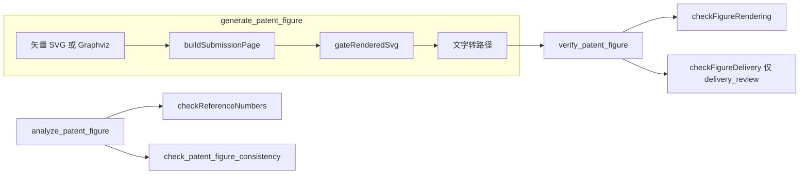

# 专利附图工具优化实现设计

| 项 | 值 |
| --- | --- |
| 作者 | 待填 |
| 日期 | 2026-11-25 |
| 状态 | Draft |
| 包 | `@deepseek-ai/dsh-patent-tools`（`packages/patent/patent-tools`） |
| 范围 | 图号用语豁免、可选视图名、页码开关、标号步进声明、图号改锚到墨迹、轮廓叠压、嵌入缩放字高。不改几何生成。 |

## Overview 概述

四件已交案的附图（汇聚箱剖视、夹具剖视、保护结构剖视、井筒变形方法流程图）图面与标记号已经符合预期，但工具在交付复核和落版上仍逼出同一类手工后处理：把落在图形正下方的「图N」报成图内注释、把中国局页码画上再手工删掉、把 `<title>` 和附图说明句改成真实视图名、把分组标号或环境件标号报成步进不一致、用留白把缩放锁在 1.0 之后图号仍按留白框而不是墨迹定位、把穿过孔的线缆拆成三段共线闭合轮廓以躲开包围盒叠压、把 `caption_font_mm` 抬到 6.13 以抵消 docx 嵌入缩小。

本设计把这些后处理收成工具入参和判据，分两期。Phase A 不改变现有调用的默认图面几何：图号位置、页码是否出现、未传新参数时的 `<title>` 与附图说明句、叠压 finding、步进警告原文都保持今天的结果。Phase A 允许的 SVG 字节差异只有落版图号和页码上的 `data-dsh-role`。另外一处默认 finding 变化写在分期表里：`Ⅰ`–`Ⅹ` 不再发 `numeralWarning`，没有开关。Phase B 会改像素或改 finding，单独 PR，并把坐标变化写成预期的快照更新，而不是静默默认。

## Background & Motivation 背景与动机

落版与复核今天是两条链，职责已经分开，问题出在链的边界上。

`resolveSubmission`（`src/tool/figure-submission.ts`）在给了 `target_office` 时**总是**调用 `sheetNumberText`，把页码写进 `SubmissionPlan.sheetNumber`。`buildSubmissionPage`（`src/figure/submission-page.ts`）在 `sheetNumber` 为 `undefined` 或空白时追加警告「附图页未写页码：每一幅附图页都应当编页码」，非 `undefined` 时用 `textElement` 画出居中 `<text>`，**没有** `data-dsh-role`。中国局档案 `office-profile.ts` 的 `sheetNumbering` 是 `'figure-pages'`，单页文案是「第1页」。这与《专利审查指南》第五部分第一章对附图页编页码的要求一致，不应改成中国局默认不编页码。四件删页码，是因为合并申请文件已经给全套文件编了页，SVG 里再留一枚「第N页」会和正文页码撞车。

`checkFigureDelivery`（`src/figure/delivery-review.ts`）把 `scan.texts` 的全部文本交给 `figureWordingWarnings`。`FIGURE_NUMBER_PATTERN`（`src/figure/wording-rules.ts`）命中「图1」「Fig. 1」「FIG. 1」就发出 `figureNumberWarning`，不看坐标。落版图号因此在 `delivery_review=true` 时必中。`verify_patent_figure` 的 `delivery_review` 默认关闭，而且**不**进入 `gateRenderedSvg`。`figure-wording` 不是 `blockingFindings` 的成员，必须维持非阻断。

`<title>` 只在矢量通路由 `vectorTitle`（`src/tool/figure-input.ts`）写成「{发明名称}的{`FIGURE_TYPE_NAMES[figureType]`}`」。`cross_section` 因此永远是「剖视图」。附图说明句由 `figureSentence` 用同一个中文图型名。Graphviz / `raw_dot` 的 `<title>` 是节点 id 和图 id（`leader-line.ts` 用它认节点），不是文档标题。四件里的真实视图名是出图后改的。

`checkReferenceNumbers`（`src/tool/analyze-patent-figure.ts`）把组件 `refNumber` 里纯数字排序，用第一对的差当步进，后面任何一对差不同就报「附图标记步进不一致：…」。1–18 这种等差不会报。同一张图里 1–11 再加环境件 21/22，或 100/110/120 与 200/210 分组合并，会报。`checkFigureSetConsistency` 只做跨图同号同名、图号连续、权利要求引用，不查步进，应继续当跨图权威。ⅠⅡⅢ 不是阿拉伯数字，今天的步进过滤 `/^\d+$/` 已经排除它们；用语侧若把它们放进标号数组，`numeralWarning` 会要求改成阿拉伯数字。局部放大标记必须留在标号集合之外。

图号纵坐标（`buildSubmissionPage`）锚在**落版图形框底**（口径 A，含 `section-diagram.ts` 的 `paddingMm`，默认 4 mm），不是墨迹底（口径 B）：

```text
captionY = margins.top + (figureAreaHeight - placedHeight) / 2 + placedHeight
           + captionGap + captionFontMm * 0.8
```

缩放比 `pageScale` 用的也是含留白的视口。汇聚箱用不同留白把四张图的缩放都锁在 1.0，图号因此离墨迹底 17–46 mm，随留白变，不随墨迹变。

`outlineOverlaps`（`src/figure/render-check-findings.ts`）用轴对齐包围盒相交，注释写明「包围盒相交即叠压」。豁免是：分组号非 `undefined` 且相同、两侧都不描边、相交区任一轴 ≤ `OVERLAP_MIN_MM`（0.2 mm）、以及 `strictlyContains`（外盒含住内盒且至少一轴严格更大）。`buildSectionDiagram` 的 `hatchGroupOf`（`section-diagram.ts` 799–807 行）只在零件给出了 hatch 规格时才分配分组号；`hatch` 省略或 `'none'` 时返回 `undefined`，孔环只是拷贝这个值（824–827 行）。顶层 `input.outline` 不写分组（810–813 行）。因此「孔和外轮廓互不比较」只在双方都带同一个非空 `data-dsh-hatch-group` 时成立，不是所有带孔零件的现有行为。分组键是剖面线参数字符串（角度、间距、方向），不是零件 id。另一零件的闭合轮廓只要包围盒部分相交就报。线缆穿过孔并伸出零件两侧时，包围盒部分相交、又不是严格包含，于是被报。交案时把线缆拆成三段共线闭合轮廓，是在迁就这条判据。开放折线本来就不进 `outlines`，不是这个缺陷。

字高下限走 `fontBelowMinimum`。量到的「字高」不是 `font-size` 属性，而是占位框高边的模，等于 `font-size × (GLYPH_ASCENT_RATIO + GLYPH_DESCENT_RATIO)` = `font-size × 0.87`（`glyph-box.ts` 的 0.75 + 0.12）。`checkFigureRendering` 把它四舍五入到 0.01 mm 后与 `minFontMm` 比较。落版回执里的 `charHeightMm` 用的是另一常数 `CHAR_HEIGHT_RATIO = 0.7`，二者不能混。`gateRenderedSvg` **不**传 `minFontMm`，所以生成门禁今天不判字高。6.13 mm 这个数来自交案时用 docx 嵌入比去凑纸面小四，不是本包里的常数；145/210 不得写进代码。



## Goals & Non-Goals 目标与非目标

**目标**

- Phase A：图号在「带 caption 角色且基线低于墨迹底」时不再报 figure-number；页码文本带 sheet-number 角色；可选 `view_name` 只替换视图名；`sheet_number: false` 不画页码且不警告，默认仍画；分析工具只在调用方声明步进方案或清单时压下步进警告。步进警告的默认原文不变。`DETAIL_MARKERS` 的 `numeralWarning` 默认跳过，不是 opt-in。
- Phase B：图号改锚到口径 B，回执给出口径 A / B / C 和 `pageScale`；叠压改为在非空同组上挖孔的轮廓相交，共边容差不窄于 0.2 mm；`embed_scale` 只参与字高下限比较，默认 1。
- 每个 PR 可独立审查。Phase A 不依赖 Phase B。PR 1、PR 3、PR 5 按这个顺序改 `buildSubmissionPage`，不要并行改图号/页码段。

**非目标**

- 不从权利要求合成机械剖视几何。
- 不在权利要求删除后自动重编号 SVG 标记。
- 不做 `annot.json` 执行器。语料里唯一的用户批注是「删除页码」，由 `sheet_number` 开关覆盖。
- 不改 FreeCAD 剖切提取、剖面线生成或引线落点算法。唯一允许碰到的绘图标记是图号/页码上的 `data-dsh-role`。不改 `freecad-section-geometry.ts` 的归并逻辑；轮廓模块只读它已导出的 `pointInPolygon`。
- 不改 `figureFailOnRenderFindings` 的阻断集合。`element-overlap` 保持阻断级。`figure-wording` 只留在交付复核，继续非阻断。
- 不把 `minFontMm` 接进 `gateRenderedSvg`。生成门禁的默认警告集不变。
- 不改四件已交案 SVG，不把它们的留白、拆段或后处理脚本收进本仓库。
- 不为 `generate_structure_figure` 增加 `view_name`。结构线稿的句子仍是「结构示意图」。
- 不按面板分别给 `view_name`。一次调用一个视图名。

## Proposed Design 方案

### 分期

| 期 | 改变默认 SVG 几何或默认 finding | 内容 |
| --- | --- | --- |
| A | 不改图面几何，不改叠压 finding，不改步进警告原文。`numeralWarning` 对 `DETAIL_MARKERS` 默认跳过 | 图号豁免、`view_name`、`sheet_number`、步进声明、细节标记 |
| B | 是 | 图号改锚与三口径回执；轮廓叠压与 `embed_scale` |

Phase A 的「默认 SVG 不变」指：不传新参数时，图号 `x`/`y`/`font-size`、页码文本是否存在及其坐标、`<title>` 文本、附图说明句、`element-overlap` 是否出现、步进警告原文，都与现在相同。全文件快照若把新属性算进去，只允许属性行差异，坐标数字不许动。`data-dsh-role` 写在 `font-size` 之后，保持 `x`、`y` 为 `<text>` 的前两个属性（`figure-submission.spec.ts` 里 `<text x="…" y="…"` 的正则依赖这一点）。

`figureWordingWarnings` 还被 `generate_patent_figure`、`generate_structure_figure`、`add_patent_figure_references` 和 `mergePanelOutputs` 用来扫标号。`DETAIL_MARKERS` 跳过 `numeralWarning` 没有开关，会改变这些调用在标号表含 `Ⅰ`–`Ⅹ` 或 `ⅰ`–`ⅹ` 时的默认用语结果。这不是「未传 `numeral_scheme`」能盖住的。步进检查仍先过滤 `/^\d+$/`，默认步进原文不变。

### 1. 图号用语豁免（Phase A）

谓词放在交付复核，不放进 `figureWordingWarnings` 的字符串参数。后者还被 `generateSingleFigure`、`mergePanelOutputs`、结构图和引线工具拿来扫**输入标签**，那些标签没有坐标，不能放宽。

`submission-page.ts` 的页面级 `textElement`（约第 296 行，不是 `section-diagram.ts` 或 `circuit-diagram.ts` 里的同名函数）增加必填角色参数：

```typescript
function textElement(
  centerX: number,
  baselineY: number,
  fontMm: number,
  text: string,
  role: 'caption' | 'sheet-number',
): string
```

输出在现有属性之外加 `data-dsh-role="caption"` 或 `data-dsh-role="sheet-number"`。属性顺序保持 `x`、`y` 在前，角色插在 `font-size` 之后、`fill` 之前。`text-anchor` 和文本字节保持原样。角色只写在该 `<text>` 自身上，不从父 `<g>` 继承，避免一组角色把图内标号一并豁免。

`render-check-scan.ts` 的 `ScannedText` 增加可选 `role?: string`，由 `textEntry` 读取**该标签**上的 `data-dsh-role`（已有常数 `ROLE_ATTRIBUTE`）。同时记下根坐标系下的基线点：`mapPoint(matrix, [x 属性, y 属性])`。不要从占位框反推基线，旋转后框边不是轴对齐的。

`checkFigureDelivery` 在调用 `figureWordingWarnings` 之前分组：

1. `role === 'sheet-number'` 的文本整段移出用语输入（标签和数字标号都不要）。它们今天不是「图N」（中国局是「第1页」/「第2页 共5页」，PCT/USPTO 是「2/5」），但角色必须在，避免以后的注释规则把页码当注释。
2. `role === 'caption'` 的文本，仅当基线根坐标 `baselineY > inkBottom` 时，从用语输入中移除。缺角色，或基线不在墨迹底之下，原样进入 `figureWordingWarnings`，图内「图1」继续警告。
3. 其余文本维持现状。

`inkBottom` 是**不含** caption 与 sheet-number 文本的墨迹 `maxY`：全部子路径顶点，加上其余文字占位框四角（与 `inkBounds` 同一套点）。比较用严格大于，不加 `AXIS_TOLERANCE_MM`。工具自己的图号在框底之下至少 `captionGap`（默认 3 mm），离 0.05 mm 容差很远。基线刚好贴在墨迹底上不算「之下」，仍警告。

没有可量测墨迹时（无顶点、无其他文字），caption **不**豁免。没有参照底边就不能声称它在图形正下方。

豁免只影响送进 `figureWordingWarnings` 的列表。`figure-photo`、`figure-orientation`、`figure-frame` 不动。`figureNumberWarning` 的原文不动。

负例与正例（写进 `delivery-review.spec.ts`）：

| SVG | 期望 |
| --- | --- |
| 矩形墨迹 `y≤80`，`<text data-dsh-role="caption" y="90">图1</text>` | 无 `figure-wording` |
| 同上但 `y="40"`（基线在墨迹内） | 仍有「图1」图号警告 |
| `y="90"` 但没有 role | 仍警告 |
| `<text data-dsh-role="sheet-number">注：见正文</text>` 加正常标号 | 页码节点不产生用语 finding；标号规则仍在 |
| 现有 `controller` 用例 | 仍是 `figure-wording` |

`gateRenderedSvg` 不调用 `checkFigureDelivery`。不要把 `figure-wording` 放进 `blockingFindings`。

### 2. view_name（Phase A）

只加在 `generate_patent_figure`。省略或空白（trim 后为空）时，`vectorTitle` 与 `figureSentence` 的字符串与今天逐字相同，`cross_section` 仍是「剖视图」。

```typescript
export function vectorTitle(
  inventionName: string | undefined,
  figureType: FigureType,
  viewName?: string,
): string {
  const title = inventionName === undefined || inventionName.trim() === ''
    ? ''
    : `${inventionName.trim()}的`
  const view = viewName === undefined || viewName.trim() === ''
    ? FIGURE_TYPE_NAMES[figureType]
    : viewName.trim()
  return `${title}${view}`
}
```

`buildOutput` 和 `mergePanelOutputs` 把同一个 `view` 传给 `figureSentence` 的 `figureTypeName`。面板后缀仍接在图号上（「图1A」），不接在视图名上。`figureType` 枚举、`buildVectorFigure` 分支、DOT 构建、索引里的 `figureType` 都不变。`indexAnalysis.overallDescription` 不写视图名。

校验：含 `\n` 或 `\r` 则 `invalid_tool_input`。trim 后长度超过 200 则拒绝（交案视图名远短于这个上限，200 只挡把说明书段落塞进标题）。不拒绝中文括号。XML 继续走 `escapeXmlAttribute`。

矢量通路：`renderSingleFigure` 把 `view_name` 传进 `vectorTitle`，仍交给 `vectorFigureSvg`。省略时 `<title>` 字节不变。

DOT / `raw_dot`：节点和 `class="graph"` 里面的 `<title>` 是 id，`leader-line.ts` 依赖它们。**禁止改写**这些标题。仅当 `view_name` 非空时，在绘图 SVG 的根 `<svg …>` 开标签后插入一行文档级 `<title>`，内容与 `vectorTitle` 相同。省略时不插入、不读回文件。插入发生在落版包进内层之前，这样文档标题留在图形 SVG 内，与矢量通路今天的位置一致。

### 3. sheet_number（Phase A）

入参 `sheet_number?: boolean`，默认 `true`。`generate_patent_figure` 与 `generate_structure_figure` 都加。未给 `target_office` 时没有落版，这个开关无效果，不报错。

`true` 或省略：`resolveSubmission` / `applyStructureLayout` 继续 `sheetNumberText(profile, sheet_index ?? 1, sheet_total ?? 1)`。中国局仍是「第1页」或「第N页 共M页」，PCT/USPTO 仍是「i/n」。`office-profile.ts` 的 `sheetNumbering: 'figure-pages'` 不改。

`false`：不调用 `sheetNumberText`，不要求 `sheet_index` / `sheet_total`。计划里的页码字符串用空字符串 `''`。

`buildSubmissionPage` 把两种「没有页码」分开，避免撞上今天的警告：

| `sheetNumber` | 画 `<text>` | 警告「应当编页码」 |
| --- | --- | --- |
| `undefined` | 否 | 是（现有库调用与 `figure-submission.spec.ts` 的用例） |
| `''` | 否 | 否（显式关闭） |
| 非空字符串 | 是 | 否 |

今天没有任何调用方传入 `''`（`sheetNumberText` 的返回值都非空），重定义空字符串是安全的。不要用空字符串去触发旧警告。

**回执为什么用空字符串，而不是新布尔或省略字段**

`LAYOUT_SCHEMA`（`figure-tool-schemas.ts` 第 26 行）和 `generate-structure-figure.ts` 内联 schema 都是 `sheetNumber: { type: 'string', required: true }`，没有 `minLength`。`SubmissionLayout.sheetNumber` 的类型是 `string`。两处模型可见渲染（`renderGenerateFigureResult` 第 99 行，结构图渲染里的「页码」行）都直接插值。

| 表示 | 结果 |
| --- | --- |
| 省略字段 | `required: true` 的输出 schema 失败 |
| 新布尔字段，同时仍写「第1页」 | 模型看到页上有页码，与 SVG 矛盾 |
| 新布尔字段，同时写空字符串 | 布尔是多余的第二事实来源 |
| 空字符串，字段仍在 | schema 通过；渲染侧见到 `''` 就不印「- 页码 …」行 |

采用最后一种。默认调用的模型文本仍是「- 页码 第1页」（或对应法域文案），逐字不变。`sheet_number: false` 时该行不出现，键 `sheetNumber` 仍在，值为 `""`。

工具描述（`generate-patent-figure.ts` 的落版段，以及结构图的对应句）补一句：`sheet_number` 默认 true；false 时不画页码、不警告。不要写成「中国局默认不编页码」。

### 4. 标号步进（Phase A）

只改 `analyze_patent_figure`。不调用 `assignFigureNumerals`，不改 SVG。

新入参：

- `numeral_scheme?: 'sequential' | 'decade-groups'`
- `numeral_manifest?: string[]`

优先级：清单 > 方案 > 今天的检查。

细节标记集合 `DETAIL_MARKERS`：`Ⅰ`–`Ⅹ`（U+2160–U+2169）和 `ⅰ`–`ⅹ`（U+2170–U+2179）。ASCII `I` / `II` / `III` **不**在集合里。

- `checkReferenceNumbers` 在数字过滤之前丢掉这个集合。对纯数字步进，这是今天 `/^\d+$/` 的显式写法，默认警告原文不变。
- `figureWordingWarnings` 的标号循环遇到这个集合就跳过，不发 `numeralWarning`。`S101` 仍警告。这是所有调用方的默认变化，见分期表。图面上的 `Ⅰ` 作为普通标签今天也不会中注释规则（非拉丁、被 `isAllowedNonChinese` 放过），保持这样。
- 不从分析结果的 `components` 里删除模型返回的 `Ⅰ`。删除会改附图说明回退句。它们只是不进入步进集合。`checkFigureSetConsistency` 已忽略非 `/^\d{1,3}$/` 的号，不要改那个模块。

`checkReferenceNumbers` 的函数体（`analyze-patent-figure.ts` 300–314 行）不去重：保留 `/^\d+$/` 的项（含 `0`），`Number` 之后排序，第一步差就是公差，差为 0 也接受。JSDoc 里的「去重」与函数体不符，不要按注释改函数体。

工具路径上的列表不是函数体的入参。`normalizeFigureAnalysis` 在 478 行先调用 `normalizeComponents`，491 行才检查。`normalizeComponents`（415–417 行）按 `refNumber` 字符串丢弃重复项。模型给出两个 `"1"` 和一个 `"2"` 时，步进列表是 `1,2`，公差 1，默认不警告。`"0","0","1"` 剩下 `0,1`，公差 1，不报「步进 0」。`figure-tools.spec.ts` 的 hostile 用例有两条 `ref_number: '1'`，随后是 `'3'` 和 `'8'`，期望句是「3 后为 8（图内前序步进 2）」，靠的就是这次去重。不要改 `normalizeComponents`。改掉它会改附图说明里的重复部件，并打掉这句步进 2。

`sequential` 的接受集是 **`normalizeComponents` 之后的那份列表**，与默认路径相同：相同字符串不进入步进；留下的数字排序后若不是一条等差（公差 0 合法），才发今天那句，数字用第一对差。不要把工具夹具写成 `1,1,2` 或 `0,0,1` 会报警。要锁住函数体里的公差 0，用去重删不掉的字符串：`"1"`、`"01"`、`"2"`。`Number` 之后是 `1,1,2`，默认和 `sequential` 都报「附图标记步进不一致：1 后为 2（图内前序步进 0），请核对是否漏标或重号」。`5,5,5` 去重后不足两个数，两边都静默；函数体直接收到三个 5 时公差 0 也接受，同样静默。1–18 在默认路径上本来就是静默的。`sequential` 不新造警告原文。

`decade-groups`：用同一份 **`normalizeComponents` 之后**的数字列表，按 `Math.floor(n / 100) * 100` 分组（0–99 为一组）。每一组内部单独要求等差，公差 0 合法；组与组之间的跳跃允许。单元素组通过。拟合则返回空警告；不拟合则落到今天的**全局**步进警告，数字仍是整表上的第一对差，不是组内另写一句。保护结构那种 100/110/120 与 200/210 同图，默认会报，声明 `decade-groups` 后不报。组内 100、110、130（公差先 10 后 20）仍然报。相同 `refNumber` 字符串在分组前已经被丢掉。

`numeral_manifest`：调用方断言本图标记就是这份清单，步进警告直接返回空，**不**把识别结果和清单做差，**不**因此新增警告。空数组，或去掉细节标记后没有任何纯数字，`invalid_tool_input`。清单里的 `Ⅰ` 被忽略，不报错。夹具的 1–11 加 21/22 既不是一条等差，也不是百位分组，走清单，不新增第三种方案。

清单会掩盖真实漏号。这是调用方的断言，不是自动核对。跨图同号同名、缺图号、权利要求里有而图中没有，仍只由 `check_patent_figure_consistency` 判定。

### 5. 图号改锚到口径 B（Phase B）

缩放仍按口径 A（含留白的视口）计算，`pageScale`、`placedWidthMm`、`placedHeightMm` 的定义不变。留白继续用来把缩放锁在 1.0，本设计不删留白，也不改 `DEFAULT_PADDING_MM`。

在写图号和页码之前，先拼出与最终页相同的 `<svg>` 视口和落版 `<g>`（外层 `translate(place) scale(pageScale)`，内层 `translate(-viewBox) scale(userUnitToMm)`，需要时再套绕版心的 `rotate`），**不要**放入图号和页码 `<text>`。对这一页调用 `scanSvg`（或已导出的 `measureInkBounds`，它就是 `inkBounds(scanSvg(svg))`）。根矩阵已经按页的 `viewBox` 把用户单位换成毫米（`render-check-scan.ts` 672–684 行），嵌套变换由遍历自己乘。得到的轴对齐盒就是页坐标上的口径 B。图号和页码不参与这个盒。

`scanSvg` 作用在**绘图** SVG 上时，点已经在绘图根的毫米坐标里。若再手写变换，只允许外层 `place + pageScale` 和绕版心的旋转。禁止再乘 `userUnitToMm` 或 `-viewBox`：内层那一档已经含在 `scanSvg` 的根矩阵里。Graphviz 常见 `width` 为 pt、`viewBox` 为点值，`userUnitToMm` 约 `25.4/72`。落版把这个缩放写成 `formatMm` 的三位小数后再扫描。72pt 夹具的扫描边长是 101.664 mm，不是连续公式的 101.6 mm。优先走「先拼页面 `<g>` 再 `scanSvg`」，避免手写两套矩阵。

不要先取轴对齐盒再旋转四个角。墨迹不满那个盒时，旋转后的四角大于真实顶点的轴对齐盒。`inkBounds` 未导出。`measureInkBounds` 返回的是你交给它的那张 SVG 的根坐标；交给绘图 SVG 时它不是页坐标，不能直接当口径 B。

无墨迹时，锚盒退回口径 A 的落版框（变换后的视口矩形，不是用户单位里的 viewBox），图号公式与今天相同。

有墨迹时：

```text
x = (ink.minX + ink.maxX) / 2
y = ink.maxY + captionGapMm + captionFontMm * 0.8
```

`0.8` 是现有基线系数，不改。水平中心从版心改为墨迹中心，所以墨迹不在留白框中心时图号会跟着走（井筒变形方法那次手工把 `x` 从 110 改到墨迹中心，就是这件事）。

然后只平移、不缩放，使图号占位框（`glyphBox`，升部 0.75、降部 0.12，不是 0.8）落在法域页边距内：

- `minX` 小于左边距则向右推；`maxX` 大于纸宽减右边距则向左推。
- `maxY` 大于纸高减下边距则上推；`minY` 小于上边距则下推。
- 页码锚点公式不动：`sheetY = margins.top + areaHeight - sheetFontMm * 0.3`。
- 夹紧后图号盒与墨迹相交，或与页码盒相交：仍画出夹紧后的图号，并追加警告「落版：图号在页边距内与墨迹或页码重叠」。不移动图形，不删页码。

汇聚箱图 2 今天图号在墨迹底之下约 46 mm，其中约 39 mm 是留白。Phase B 后再加默认间距 3 mm 和 `0.8 × 字号`，图号上移进留白带，仍在页边距内。这是预期的坐标变化。`figure-submission.spec.ts` 里墨迹贴齐视口底边的用例，`y` 应保持；视口大于墨迹的用例必须改期望值，不能为了维持旧 `y` 把锚退回口径 A。

另加一张 Graphviz 型夹具：`width="72pt" height="72pt" viewBox="0 0 72 72"`，一个铺满 viewBox 的矩形，经默认 cnipa 落版，并带图号（这样才有 `y` 可断言）。`parseLengthMm("72pt")` = `(72 / 72) × 25.4` = 25.4 mm，这只是绘图视口，不是页上墨迹边长。

默认 cnipa 的可绘图宽是 `210 - 25 - 15 = 170` mm，可绘图高是 `297 - 25 - 15 = 257` mm。有图号时图区高再减 `DEFAULT_CAPTION_GAP_MM + DEFAULT_CAPTION_FONT_MM` = `3 + 4`，得 250 mm；没有图号时图区高是 257 mm。这条夹具的限制轴是宽：`rawScale = min(170 / 25.4, 图区高 / 25.4) = 170 / 25.4 ≈ 6.693`，被 `MAX_PAGE_SCALE`（4）截成 `pageScale = 4`。图号块不改变这个截断。`pageScale` 写在度量对象上，仍是 4，不受小数位数影响。`rawScale > 4` 会带上已有的「放大被限制在 4 倍」警告，夹具要允许它，不要为了清掉警告把缩放改成 1。

夹具扫描的是已经写成字符串的落版页。内层 `scale(userUnitToMm)` 经过 `formatMm`（`MM_DECIMALS = 3`，`submission-page.ts` 249 行）：`25.4 / 72 ≈ 0.352778`，`Math.round(value * 1000) / 1000` 得到 `0.353`。铺满 viewBox 的 72 再乘外层 4，扫描边长是 `72 × 0.353 × 4 = 101.664` mm。连续公式 `25.4 × 4 = 101.6` 只说明截断前的量级，不能当扫描断言。不要为了得到 101.6 去改 `formatMm`，也不要把 SVG 里的缩放写成未舍入的数。

断言 `pageScale === 4`，扫描到的墨迹宽和高都是 101.664 mm，图号 `y` 等于该扫描墨迹底 + `captionGap` + `0.8 × font`。错误对照：漏乘 `pageScale` 时边长约 25.4 mm，或只剩内层舍入后的 `72 × 0.353 = 25.416` mm；在扫描边长 101.664 mm 上再乘 `25.4/72` 约 35.865 mm。这些都必须失败。若以后改成必须 `pageScale === 1` 的夹具，绘图视口要接近 170 mm 的可绘图宽，不能再用 72pt 的小图。

回执在 `SubmissionPageMetrics` 和 `SubmissionLayout` 上**追加**字段，不改已有字段的含义：

```typescript
type PageBoxMm = { minX: number; minY: number; maxX: number; maxY: number }

layoutFrame: PageBoxMm   // 口径 A，落版后的图形视口轴对齐盒，含留白
inkBounds: PageBoxMm     // 口径 B，页坐标，不含图号与页码
pageWidthMm: number      // 口径 C
pageHeightMm: number
```

数值用 `formatMm` 的千分之一毫米（`MM_DECIMALS = 3`）再转回数字。`placedWidthMm` 仍是口径 A 的宽，不是墨迹宽。

`LAYOUT_SCHEMA` 与结构图内联输出 schema 都要加上这些属性（`additionalProperties: false`）。有 `layout` 时总是带上，标 `required: true`。`structure-render.ts` 现在是手工拼 `SubmissionLayout`，必须在同一 PR 里填上，不能只改 `buildLayout`。

`renderGenerateFigureResult` **保留**现有行「缩放 …，图形 …×… 毫米」。在它后面追加三行口径，避免打断已经依赖旧行的阅读。结构图的文本渲染同样追加。这是 Phase B 的模型可见变化，和坐标变化一起出现。

### 6. 轮廓叠压（Phase B）

替换 `outlineOverlaps` 的判定，不替换 `check` id，不把该 finding 降为 `advisory`。`blockingFindings` 的过滤条件不变。注释改成轮廓填充区域相交，删掉「包围盒相交即叠压」。

新模块 `src/figure/contour-overlap.ts`。不新增 npm 依赖：调用点只有这一处，通用裁剪库要过产品依赖政策，而错裁剪会藏缺陷，审查一份带夹具的局部算法比审查一个新依赖更直接。射线法用已导出的 `pointInPolygon`（`freecad-section-geometry.ts` 325–335 行）。不修改那个文件。不导出、不调用未导出的 `classifyRings`：它用 `points[0]` 做探针（292–293 行），而该函数自己写明边界上的判定不确定（320–323 行）。整段复制也会撞 `pnpm run duplication`（`.jscpd.json`：6 行 / 60 token）。下面的父指针是按它的合同重写的规则，不是把函数体搬过来。面积只在本地写 `Math.abs(鞋带和) / 2`，不要把未导出的 `polygonArea` 再抄成一个函数。

**零件**。闭合子路径沿用今天的收集顺序。只有分组号不是 `undefined` 且彼此相等的环才合成一个零件，才能在零件内部挖孔。分组号为 `undefined` 的环各自一件，是实心轮廓，不从任何外轮廓里减掉。这与今天的短路一致：`outlineOverlaps` 仅当分组号非空且相等才跳过比较。零件「描边」当且仅当它至少有一个 `stroked === true` 的环。两侧都不描边则跳过。

挖孔的前提因此是：外环和孔环都写出了同一个非空 `data-dsh-hatch-group`。`hatch` 省略或 `'none'`、以及只靠顶层 `input.outline` 的带孔零件，孔环不会被挖掉，线缆穿过孔腔仍报叠压。不要改 `hatchGroupOf`，也不要把它改成零件 id（非目标：不改剖面线发射）。分组键是剖面线参数，不是零件 id。两件 hatch 角、间距、方向相同会得到同一个号；今天已经因同组而整对不报。新算法在该组内做深度，同样不互比；一件的环若几何上落在另一件内，会被当成那件的孔。这是与「同组不互比」对齐的限制，不是新的静默。

**填充区域**。只在同一个非空分组内算深度。探针不用 `points[0]`，也不用顶点质心：墙 `(20,0)-(40,40)` 与孔 `(20,10)-(40,30)` 的质心都是 `(30,20)`，质心会把外轮廓判进孔里。对环的每条边取中点，沿内法向偏移 `0.01` mm（必须大于 `1e-4` mm）。有向面积为正（逆时针）时内法向是左法向 `(-dy, dx)`，为负时是 `(dy, -dx)`。探针被接受的条件：`pointInPolygon` 为真，且到本环每条边的距离大于 `1e-4` mm。一个环可以有多个被接受的探针。

深度 = 这些探针里，落在其他环严格内部（`pointInPolygon` 且到该环边界大于 `1e-4` mm）的个数的**最小值**。靠共享边的偏移会掉进孔里，个数偏大；贴着外环、不在孔里的探针个数才是嵌套深度。取最小值才能稳住夹具 10。没有任何被接受的探针：这一对按追环失败报 `element-overlap`，不要退回 `points[0]`。比 `0.02` mm 还薄的环会走这条失败路径。

父指针：在深度恰好比自己小 1、且包含本环某个最小深度探针的环里，取文档序最小的下标。偶数深度是壳或岛，奇数深度是孔。直接子孔 = 父指针指向该壳的环。点在填充内：到边界的距离大于 `1e-4` mm，严格落在某个偶数环内，且不严格落在该环的任一直接子孔内。

**先做与今天相同的包围盒短路**，再做轮廓，这样现有用例的结论不变，也避免把「严格包含」改严：

1. 两零件包围盒（各环包围盒的并）的相交宽 ≤ 0.2 **或** 相交高 ≤ 0.2：不报。`OVERLAP_MIN_MM` 仍是 0.2，不改数值。轴对齐共边在这里就返回，走不到轮廓。
2. `strictlyContains` 任一方向：不报。完全重合不是严格包含，不能在这里返回。这一步**故意保留**今天的假阴性：C 形零件的包围盒含住开口里的另一零件时不报。夹具里要有一条锁定这个假阴性，防止实现时「顺便修掉」。
3. 其余进入轮廓相交。

**相交**。只对两零件的壳和孔的边做。剖面线、中心线、引线是开放段，不在 `outlines` 里，不要参与。顶点数按一张图几十个闭合轮廓估计，成对边相交是工具调用里的毫秒级工作，不引入空间索引。

1. 两边的每条边求交。端点分居两侧、参数都在开区间 `(0,1)` 的是交点，两边都在该点拆开。一端点到另一条边的内部距离 ≤ `1e-4` mm 是 T 接，在那个点拆开被触到的边。
2. 共线重叠是一段，不是点和 T 接。两条边各自的端点到对方直线的距离都 ≤ `1e-4` mm，且在该直线上的投影重叠长度大于 `1e-4` mm 时，在重叠段的两个端点拆开两条边。落在重叠段上的片段只作边界。
3. 片段中点到任一多边形边界的距离 ≤ `1e-4` mm，视为在边界上，**不是**内部，也**不是**追环失败。`pointInPolygon` 对边界的结果不稳定，共边必须靠这个距离。
4. 中点到两个填充区域的边界都大于 `1e-4` mm，且同时落在两个填充区域内的片段，才是相交内部。
5. 没有内部片段：不报。共边、只在顶点相接、线缆只走在孔里，都停在这里。
6. 有内部片段：追成环。鞋带和取绝对值（`polygonArea` 是有向面积，顺时针为负；负面积不是共边，不许因此丢弃）。追不成环：**报** `element-overlap`，文案说明轮廓相交未能闭合、按叠压报告。不许返回空 finding。不要做三角剖分，剖分失败也不单独作为报叠压的条件。宽度只走下面的边厚度。

**最小宽度**是相交环每条边的内法向厚度的最小值。它不读顶点表的起点，不连对角线，不耳切，也不取凸包。这条薄 L 的凸包是 `(0,0)-(8,0)-(8,0.15)-(0.15,8)-(0,8)`，斜边 `x + y = 8.15` 到 `(0,0)` 的距离是 `8.15 / √2 ≈ 5.76` mm。旋转卡尺等于这个凸包宽度，两种起笔都会报成叠压，仍然禁止。

一条边的厚度：内法向与深度探针相同（有向面积为正时左法向 `(-dy, dx)`，为负时 `(dy, -dx)`，单位化）。采样点是边中点，以及两端各沿边向内退 `1e-4` mm 后再沿内法向前进 `1e-4` mm。从每个采样点沿内法向找与其他边的最近交点：交点在那条边的线段上，且距离 `t > 1e-4` mm。三个采样里最小的 `t` 就是这条边的厚度。三个都没有交点的边不参与。环的最小宽度是所有参与边的厚度的最小值。一条边都没有厚度：报 `element-overlap`，不要改用凸包。

凸环上，边中点的内法向打到对边。正方形得到边长，不是 `边长 / √2`。正 n 边形、半径 R、对边平行时得到 `2 R cos(π / n)`。半径 2 mm 的正 64 边形约为 `4 × cos(π / 64) ≈ 3.995` mm。0.15 mm 的凸条带得到条宽。耳切会把 0.25 mm 正方形收成约 0.177、把这个 64 边形收成约 0.196，不要耳切。

非凸环用同一公式，不读 `points[0]`。外臂上的边打到平行的内边，得到臂厚。L 的短端面沿臂长打到对面外壁，厚度是臂长（这条 L 是 8 mm），不是臂厚。环宽取各边厚度的最小值，短端面不抬高结果。臂厚 0.15 mm 的 L，从 `(0,0)` 或从 `(8,0)` 起笔，宽度都是 0.15 mm，不报。壁厚 0.15 mm 的 C 也是 0.15 mm，两种起笔都不报。臂厚或壁厚 0.5 mm 则大于 0.2 mm，两种起笔都报。不要把凹顶点连到「文档序最小的可见顶点」：同一条 L 改成从 `(8,0)` 起笔时，那条对角线会切出约 7.85 mm 的块。也不要再换一种对角线。

**报与不报**。没有内部片段：不报。每个相交环的最小宽度 ≤ `OVERLAP_MIN_MM`：该块是擦边，不报。任一环的最小宽度 > 0.2 mm：报。面积的符号不参与这个判断。

文案保留数字子句，方便现有矩形用例不动：`相交 ${宽}×${高} 毫米（相交区 x …–…／y …–…）`，宽高和区间取相交区域的轴对齐盒，四舍五入到 0.1 mm（与现在的 `round` 一致）。矩形部分相交时，这个盒等于今天的包围盒相交区，所以 `5.2×4` 与 `x 34.8–40／y 10–14` 仍成立。不要为斜边改这条文案。前提从「两个闭合轮廓的包围盒相交」改为「两个闭合轮廓的填充区域相交」。图元编号仍是闭合子路径文档序的 1 起下标；一个零件多环时用其中最小下标。

`verify_patent_figure` 的描述段和 `render-check.ts` 文件头里「包围盒部分相交」的句子在同一 PR 改成填充区域相交，并写明：同材料分组、严格包含、开放折线、两侧纯填充仍不报；共边与穿孔不报；没有分组的孔不会被挖掉。

夹具矩阵放在新文件 `tests/figure-contour-overlap.spec.ts`，调用 `checkFigureRendering`。`figure-render-check.spec.ts` 里已有的叠压用例必须保持绿色，作为回归锁，不要把它们搬走。

| # | 几何 | 期望 |
| --- | --- | --- |
| 1 | 现有部分相交矩形 5.2×4；再把其中一个矩形顶点序反转 | 两次都是 `element-overlap`，坐标子句不变。顺时针环不能因负面积被丢掉 |
| 2 | 圆严格在矩形内 | 无 finding |
| 3 | 两矩形共一条竖直边 | 无 finding |
| 4 | 同 `data-dsh-hatch-group` 的两矩形相交 | 无 finding |
| 5 | 两个完全重合的矩形 | `element-overlap` |
| 6 | 相交宽 0.1 mm | 无 finding |
| 7 | 开放折线穿过矩形 | 无 finding |
| 8 | 两侧 `stroke="none"` | 无 finding |
| 9 | 一侧描边、一侧填充，部分相交 | `element-overlap` |
| 10 | 墙 `(20,0)-(40,40)`，孔 `(20,10)-(40,30)` 同一非空分组；线缆闭合矩形 `(0,14)-(60,26)`。孔的顶点表分别以左缘 `(20,10)` 和右缘 `(40,10)` 起笔各跑一次 | 两次都无 finding。线缆在墙的 x 范围内完全落在孔里，两侧伸出墙外，包围盒部分相交。禁止依赖 `points[0]` |
| 11 | 同一墙和孔；线缆 `(0,2)-(60,12)`，穿入孔以外的材料 | `element-overlap` |
| 12 | 两三角形只共斜边 `(0,20)-(20,0)` | 无 finding。共线重叠段只作边界，不得记成追环失败 |
| 13 | 正方形 `(0,0)-(20,20)` 与沿对角线、宽 0.15 mm、两端伸出正方形的闭合条带 | 无 finding。包围盒相交远大于 0.2，且互不严格包含，必须靠最小宽度 |
| 14 | 同一条带宽 0.5 mm | `element-overlap` |
| 15 | C 形外轮廓的包围盒严格含住开口里的小矩形，小矩形不与 C 的材料相交 | 无 finding。这是保留的 `strictlyContains` 假阴性 |
| 16 | 小矩形严格落在孔内，其包围盒也严格落在外轮廓内 | 无 finding |
| 17 | 两段共线线缆只共一个端点 | 无 finding |
| 18 | 与第 10 条同一几何，但墙和孔都不写 `data-dsh-hatch-group` | `element-overlap`。无分组时不挖孔，与今天的互比结论相同 |
| 19 | 臂厚 0.15 mm 的 L，顶点 `(0,0)-(8,0)-(8,0.15)-(0.15,0.15)-(0.15,8)-(0,8)`，以及把同一环改成从 `(8,0)` 起笔；另一轮廓是正方形 `(0,0)-(8,8)` | 两次都无 finding。宽度是臂厚 0.15 mm，不随起点变。凸包卡尺和对角线切分都会大于 0.2 mm，不能拿它们过这条 |
| 20 | 与第 19 条相同的两种起笔，臂厚改为 0.5 mm | 两次都是 `element-overlap` |
| 21 | 矩形 `(0,0)-(1,0.25)` 与 `(0,0)-(0.25,1)`，相交是边长 0.25 mm 的正方形 | `element-overlap`。两轴都大于 0.2，今天的包围盒短路不会提前返回。耳切指标约 0.177，不能拿它过这条。文案按 0.1 mm 舍入，0.25 会写成 0.3，不要断言字符串「0.25」 |
| 22 | 半径 2 mm 的正 64 边形，另一轮廓是与其包围盒重合的正方形 | `element-overlap`。两盒相等，不是严格包含。相交环至少 64 个顶点，内法向厚度约 3.995 mm。耳切指标约 0.196，不能拿它过这条 |
| 23 | 壁厚 0.15 mm 的 C：`(0,0)-(8,0)-(8,0.15)-(0.15,0.15)-(0.15,7.85)-(8,7.85)-(8,8)-(0,8)`，以及从 `(8,0)` 起笔的同一环；另一轮廓是正方形 `(0,0)-(8,8)` | 两次都无 finding |
| 24 | 壁厚 0.5 mm 的 C：`(0,0)-(8,0)-(8,0.5)-(0.5,0.5)-(0.5,7.5)-(8,7.5)-(8,8)-(0,8)` | `element-overlap` |

第 13 条的条带顶点按对角线法向偏移半宽生成，写在测试里，并断言最小宽度路径被走到（不能被第 2 步的严格包含提前返回）。第 10 条是汇聚箱把线缆拆成三段的那类几何，拆段不再是过检手段；它只在孔和外轮廓共享非空分组时成立。第 19、23 条锁住「宽度不随起点变化，也不用凸包」。第 21、22 条锁住「不用耳切」。

### 7. embed_scale（Phase B）

只影响 `fontBelowMinimum`。默认 1。不出现在生成门禁里。

入参 `embed_scale?: number`，加在 `verify_patent_figure` 和 `checkFigureRendering` 的 options 上。缺省、或调用方不传，比较路径与今天相同。`≤ 0` 或非有限数：`invalid_tool_input`，与 `min_font_mm` 相同。

纸面字高用的是**已经量到的墨迹高**，不是 `font-size` 属性，也不是落版回执的 `charHeightMm`（0.7）：

```text
svgInkMm = round2(|glyphBox 高边|)     // 今天的字高，= font-size_mm × 0.87
paperMm  = embedScale === 1
  ? svgInkMm
  : round2(svgInkMm × embedScale)
```

`round2` 是现有的 `Math.round(x * 100) / 100`。`embedScale === 1` 时禁止再乘再舍入，比较值与消息里的毫米数必须与今天逐位相同。下限比较用 `paperMm < floorMm`。

报告字段 `minFontMm` **仍是**未缩放的 SVG 墨迹最小值。消费者和交案记录里的「最小字高 4.35 / 5.33」指的是这个数。不要改成纸面值。

`embedScale !== 1` 时，finding 里每个命中文字写成：`「图1」纸面 3.68 毫米（SVG 墨迹 5.33 毫米 × embed_scale 0.690476）`。模型可见的量测行在最小字高后追加纸面最小字高和缩放。`embedScale === 1` 时不要追加，消息维持现有模板。

数值例子（不是代码里的常数）：`font-size` 6.13、页内无额外缩放时，SVG 墨迹为 `round2(6.13 × 0.87) = 5.33`。调用方若知道这次嵌入把 SVG 页高放进 H 毫米的版心，传入 `embed_scale = H / svgPageHeightMm`。历史上的 docx 用过 145/210，由**归档渲染器**在知道版心高度时传入。本包不写 145、210 或它们的商。注意：交案时有人用 `6.13 × 145/210 ≈ 4.23` 去凑**字号属性**；工具下限比较的是 0.87 墨迹。`embed_scale` 缩放的是墨迹，不是属性。用属性去对下限会在缩放为 1 时把 5.0 mm 字号从 4.35 改判成 5.0，直接破坏现有内控。

`gateRenderedSvg` 继续不传 `minFontMm`，因此也不传 `embed_scale`。

## API / Interface Changes 接口

`generate_patent_figure` 入参追加：

```typescript
view_name?: string
sheet_number?: boolean   // 默认 true
```

`generate_structure_figure` 只追加 `sheet_number`。

`analyze_patent_figure` 入参追加：

```typescript
numeral_scheme?: 'sequential' | 'decade-groups'
numeral_manifest?: string[]
```

`verify_patent_figure` 入参追加：

```typescript
embed_scale?: number     // 默认 1，只参与 font-below-minimum
```

`SubmissionLayout` / `LAYOUT_SCHEMA` 在 Phase A 不增字段。`sheetNumber` 保持 `required: true` 的字符串；显式关闭时为 `""`。

Phase B 的 `layout` 追加 `layoutFrame`、`inkBounds`、`pageWidthMm`、`pageHeightMm`，有落版时必填。已有 `pageScale`、`placedWidthMm`、`placedHeightMm`、`caption`、`sheetNumber` 的类型和默认取值不变。

`ScannedText` 追加 `role?: string` 与根坐标基线。这是扫描结果，不是工具 schema。

`checkFigureRendering` 的 options 追加 `embedScale?: number`。

不改 `SessionEventMap`，不改 Python SDK。这些工具的模型可见文本在 Phase A 仅当传入新参数时变化；Phase B 的落版回执多三行口径，快照在那个 PR 里更新。

## Data Model Changes 数据

无持久化 schema、无 SQLite、无会话事件。附图索引仍记录 `figureType` 枚举，不记录 `view_name`。`view_name` 只出现在该次输出的 `figureDescription` 和 SVG `<title>` 里；索引若保存了 `figureDescription`，会带上视图名，这是句子本身，不是新列。

页码关闭不写入新列，用已有字符串的空值表示。

迁移：无。回滚即还原对应 PR。已生成的旧 SVG 没有 `data-dsh-role`，交付复核会继续警告它们的「图N」，直到重新落版。不要写迁移脚本去改四件档案。

## Alternatives Considered 备选

| 方案 | 优点 | 代价 | 结论 |
| --- | --- | --- | --- |
| 图号只要文本是「图N」且在页面下半部就豁免 | 旧 SVG 不用重出 | 图内下半部的「图1」也被放过；与「图内仍警告」相反 | 拒绝 |
| 角色加基线低于墨迹底 | 工具落版的图号豁免，图内「图1」仍警告 | 旧 SVG 无角色，重出前仍警告 | **采用** |
| 中国局默认不画页码 | 四件不用再传开关 | 违反第五部分第一章对单独附图页的页码要求；PCT/USPTO 与中国局行为分裂 | 拒绝 |
| 关闭页码时省略 `sheetNumber` 字段 | 模型看不到页码行 | `required: true` 的两处输出 schema 失败 | 拒绝 |
| 关闭页码时加布尔字段并保留「第1页」文案 | schema 不必动空字符串 | 回执撒谎 | 拒绝 |
| 关闭页码时 `sheetNumber: ""` 且不画、不警告 | 满足 required string；渲染可跳过空行 | 空字符串与 `undefined` 的语义必须在 `buildSubmissionPage` 写死 | **采用** |
| `view_name` 改 `figure_type` 枚举 | 少一个参数 | 剖视/流程图通路被换成另一套几何 | 拒绝 |
| 省略 `view_name` 时仍写「剖视图」，传入时只换标题和句子 | 默认字节不变 | 多一个可选字符串 | **采用** |
| 维持包围盒相交 | 零风险改判 | 穿孔线缆继续被拆段；注释与图面不符 | 拒绝 |
| 栅格化后数重叠像素 | 看起来像「真重叠」 | 依赖分辨率，和矢量门禁的「不需要栅格器」相反，线宽会把共边涂成重叠 | 拒绝 |
| 填充区域相交；只在非空同组上挖孔；相交环自身最小宽度 ≤ 0.2 mm 视为擦边；严格包含仍按包围盒短路 | 穿孔不报，真部分相交仍报，薄 L 不报，现有矩形用例的数字能保住 | 实现错误会藏缺陷；C 形开口里的零件继续不报；无分组的孔仍报 | **采用** |
| 用凸包旋转卡尺当最小宽度 | 凸条带的宽度正好，且与起点无关 | 薄 L 的凸包最小宽度约 5.76 mm，夹具 19 两种起笔都会误报 | 拒绝 |
| 凹顶点连到文档序最小的可见顶点再取凸块卡尺 | 从 `(0,0)` 起笔的薄 L 能不报 | 从 `(8,0)` 起笔会切出约 7.85 mm 的块；下一条换起点的环还能再被打穿 | 拒绝 |
| 耳切三角形最小高的最大值 | 薄条带和薄 L 能不报 | 0.25 mm 正方形变成约 0.177，正 64 边形变成约 0.196，真叠压被静默 | 拒绝 |
| 导出 `classifyRings` 或复制其 `points[0]` 探针 | 少写一套父指针 | 孔与外轮廓共边时深度会翻转，夹具 10 报成叠压；复制还会撞 jscpd | 拒绝 |
| `embed_scale` 默认 145/210 | 交案 docx 不用传参 | 不是所有嵌入都是这个比；默认即改变字高判定 | 拒绝 |
| 用 `font-size × embed_scale` 去比下限 | 和「6.13×145/210≈4.23」的手工算法一致 | 缩放为 1 时 5.0 mm 字号不再按 4.35 比较，内控含义变了 | 拒绝 |
| 纸面高 = 已报告的 0.87 墨迹 × `embed_scale`，默认 1 | 默认比较值逐位不变 | 调用方必须自己算嵌入比 | **采用** |
| 图号锚点用配置开关保留口径 A | 回滚不用还原 PR | 两套默认，快照和交案会混用 | 拒绝 |
| Phase B 直接改锚，快照跟 PR 走 | 只有一个默认 | 已有调用的坐标会变，必须在 PR 说明里写明 | **采用** |

## Security & Privacy Considerations 安全与隐私

没有新的网络、凭据或跨用户数据。输入仍是调用方的 SVG 和工具参数。

`data-dsh-role` 的信任模型与现有 `data-dsh-role="leader"` 相同：绘图侧标记可以让净距或用语检查跳过该元素。图号豁免比引线严，因为还要基线低于墨迹底。只打上角色、位置仍在图内的「图1」不会被放过。外部 SVG 若把一段真注释标成 `sheet-number`，交付复核会跳过该节点的用语检查。这是低严重度，和引线豁免同一类；不扩大到任意角色，角色字符串必须全字匹配。

`view_name` 进入 XML 文本节点前走 `escapeXmlAttribute`。拒绝换行，避免把标题拆成第二行图面文字。它不进入几何参数。

`sheet_number: false` 是显式布尔。禁止从法域、文件名或「这是中国案」推断。

轮廓模块的失败方向规定为「算不出就报叠压」。严重度高的失败模式是假阴性。夹具矩阵是合并条件，不是补充说明。`element-overlap` 保持阻断，避免有人用 `advisory` 把判错的结果从 `failOnFindings` 里拿掉。

`embed_scale` 不改 SVG，只改比较。恶意的极大缩放会制造字高 finding，不会改文件。极小正数同样只多报 finding。`≤ 0` 直接拒绝。

## Observability 可观测性

这些工具没有独立指标管道。信号就是现有的 `warnings` 和 `findings[].check`。

稳定 id：`figure-wording`、`element-overlap`、`font-below-minimum`。不改 id，不新增 id，除非轮廓追环失败——那种情况仍用 `element-overlap`，不要造 `element-overlap-unresolved`，否则阻断过滤和现有仪表会分叉。

`embed_scale !== 1` 时，finding 和复核文本必须同时写出 SVG 墨迹和纸面字高。只有纸面数会让模型去改一个已经够大的 `font-size`。

生成门禁的警告前缀仍是「渲染复核：」。交付用语只在 `verify_patent_figure` 且 `delivery_review=true` 时出现，前缀仍是 `[figure-wording]`。不要把用语警告复制进 `gateRenderedSvg`。

Phase B 落版回执追加口径 A/B/C 三行。默认 Phase A 回执不追加，避免模型可见文本在几何还没变时先变。

## Rollout Plan 发布

没有功能开关框架，也不加「旧图号锚点」配置。入参默认值就是兼容开关：`sheet_number` 默认开，`view_name` 默认省略，`numeral_scheme` / `numeral_manifest` 默认省略，`embed_scale` 默认 1。

Phase A 四个 PR 可以在 Phase B 之前全部合并。PR 1、PR 3、PR 5 按这个顺序落地。合并 Phase A 之后，未传新参数的调用：页码仍在，图号坐标仍在，句子仍是「剖视图」，步进警告原文仍在，叠压结论仍在。默认字节差异是图号和页码的 `data-dsh-role`。默认用语差异只有一条：标号表里的 `Ⅰ`–`Ⅹ` / `ⅰ`–`ⅹ` 不再出现 `numeralWarning`。用属性断言更新全文件快照，不要改坐标期望。

Phase B 的图号 PR 会改有留白的图的坐标。PR 描述里写明这是预期快照更新。回滚就是还原该 PR，不要保留双锚点。轮廓 PR 的回滚同样是还原；它不改 SVG 字节，只改 finding。两个 Phase B PR 不要打在同一个变更里，这样还原叠压不会把图号坐标一起还原。

发布对象是工具包本身。不要求重新生成四件档案，不要求生产发布。对外发送和合并仍要单独批准。

测试命令用聚焦的 vitest，不要默认 `pnpm run test`（它会先编 native）或 `test:coverage`：

```text
pnpm exec vitest run packages/patent/patent-tools/tests/<本 PR 点名的文件>.spec.ts
```

改了工具描述或 README 表的 PR，额外跑文档门禁里会扫到这些文件的检查；不要为了本改动跑全仓库 `doc-sync`，除非该 PR 改了 `docs/` 下的叙述。本设计不要求改 `docs/`，包内 `README.md` 与 `README.zh.md` 的工具行要在行为变更的那个 PR 里一起改。

## Open Questions 未决问题

无。`sheetNumber` 的 `required: true` 与「可以不画页码」并不冲突：两处消费者（`LAYOUT_SCHEMA` 与结构图内联 schema）都要一个字符串，都没有 `minLength`，空字符串同时满足。渲染函数是唯一会把空字符串印成「- 页码 」的地方，在同一变更里跳过该行即可。没有第二个消费者要求非空页码。

## References 参照

- `packages/patent/patent-tools/src/figure/wording-rules.ts`：`FIGURE_NUMBER_PATTERN`、`figureNumberWarning`、`figureWordingWarnings`
- `packages/patent/patent-tools/src/figure/delivery-review.ts`：`checkFigureDelivery`
- `packages/patent/patent-tools/src/figure/submission-page.ts`：`buildSubmissionPage`、`textElement`、`CHAR_HEIGHT_RATIO`
- `packages/patent/patent-tools/src/tool/figure-submission.ts`：`resolveSubmission`
- `packages/patent/patent-tools/src/figure/office-profile.ts`：`sheetNumberText`、cnipa `sheetNumbering: 'figure-pages'`
- `packages/patent/patent-tools/src/figure/figure-description.ts`：`figureSentence`
- `packages/patent/patent-tools/src/tool/figure-input.ts`：`vectorTitle`
- `packages/patent/patent-tools/src/figure/render-check-findings.ts`：`outlineOverlaps`、`strictlyContains`、`blockingFindings`、`fontBelowMinimum`、`OVERLAP_MIN_MM`
- `packages/patent/patent-tools/src/figure/render-check-gate.ts`：`gateRenderedSvg`
- `packages/patent/patent-tools/src/figure/render-check-scan.ts`：`data-dsh-role`、`ScannedText`
- `packages/patent/patent-tools/src/figure/glyph-box.ts`：升部 0.75、降部 0.12
- `packages/patent/patent-tools/src/tool/verify-patent-figure.ts`：`delivery_review`、`min_font_mm`
- `packages/patent/patent-tools/src/tool/analyze-patent-figure.ts`：`checkReferenceNumbers`、`FIGURE_TYPE_NAMES`
- `packages/patent/patent-tools/src/tool/figure-tool-schemas.ts`：`LAYOUT_SCHEMA.sheetNumber`
- `packages/patent/patent-tools/src/tool/figure-output.ts`：`renderGenerateFigureResult`
- `packages/patent/patent-tools/src/figure/section-diagram.ts`：`paddingMm`、`hatchGroupOf`（省略或 `'none'` 时不分组）、孔环拷贝该分组
- `packages/patent/patent-tools/src/figure/freecad-section-geometry.ts`：`pointInPolygon` 的边界合同；`classifyRings` 未导出且探针是 `points[0]`，不要调用
- `.jscpd.json`：重复检测门槛 6 行 / 60 token
- 交案图面事实（只取绘图工具行为，不取案卷其他内容）：汇聚箱 `figure-deliverable.md` 的口径 A/B/C、留白锁缩放 1.0、图号警告关闭、线缆拆段；夹具的 1–11 与 21/22、出图后改标题和删页码；保护结构的百位分组、`caption_font_mm=6.13`、ⅠⅡⅢ；井筒变形方法的 `raw_dot`、同一图号误报、删页码、docx 嵌入后的纸面字高
- 现有计划的写法参照：`reports/freecad-implementation-plan.md`（不包含其 FreeCAD 范围）

## Key Decisions 关键决定

**图号豁免谓词。** 只豁免同时满足 `data-dsh-role="caption"` 且基线根坐标严格低于「不含图号和页码的墨迹底」的文本。图内「图1」即使带了角色也警告；图形下方的「图1」没有角色也警告。谓词放在 `checkFigureDelivery`，不放进纯字符串的 `figureWordingWarnings`，避免生成通路的输入标签被放宽。页码节点打 `sheet-number` 并整段退出用语输入。`figure-wording` 仍不进生成门禁。

**页码默认保持开启。** 单独附图页要编页码。四件删除页码是因为合并申请文件另有页码，不是因为中国局档案不该编。`sheetNumbering` 保持 `'figure-pages'`。关闭是调用方的 `sheet_number: false`。回执用空字符串而不是省略字段，因为 `LAYOUT_SCHEMA` 和结构图 schema 都把 `sheetNumber` 标成必填字符串；渲染在空字符串时不印页码行。`undefined` 继续警告，用来区别「没传」和「显式关闭」。

**view_name 默认不改变字符串。** 省略时 `vectorTitle` 和 `figureSentence` 仍用 `FIGURE_TYPE_NAMES`，剖视图仍写「剖视图」。传入时只替换视图名，不改 `figure_type`，不改几何通路，不改 Graphviz 节点 `<title>`。

**叠压算法。** 用填充区域相交，不用栅格，不保留「包围盒相交即叠压」。只有同一个非空 `data-dsh-hatch-group` 里的环才挖孔；探针是边上的内点，深度取各探针的最小值，不用 `points[0]`。无分组的孔不挖。共线重叠只作边界。面积取绝对值。最小宽度是每条边内法向厚度的最小值，不切分，不读起点。不用耳切，也不用凸包。≤ 0.2 mm 不报，容差就是现有 `OVERLAP_MIN_MM`。线缆只在孔与外轮廓同组时穿过孔不报；轮廓真的部分相交且最小宽度大于 0.2 mm 仍报。`strictlyContains` 仍按包围盒短路，包括它的假阴性。追环失败必须报，不许当成不相交。不把三角剖分失败当成报叠压的条件。`element-overlap` 保持阻断。

**embed_scale 默认 1。** 纸面字高 = 今天报告的 SVG 墨迹（`font-size × 0.87`，已舍入）× `embed_scale`。缩放为 1 时比较值不再次舍入。不乘 `font-size` 属性，不用 `CHAR_HEIGHT_RATIO` 0.7，不写 145/210。报告字段 `minFontMm` 保持 SVG 墨迹。参数只在 `verify_patent_figure` / `checkFigureRendering`，不进生成门禁。

**sequential 看的是 `normalizeComponents` 之后的列表。** 相同 `refNumber` 字符串不进入步进。不要改 `normalizeComponents`。函数体仍允许公差 0；工具夹具用 `"1"`、`"01"`、`"2"` 锁住「1 后为 2（图内前序步进 0）」，不用 `1,1,2` 或 `0,0,1`。`5,5,5` 两边静默。hostile 用例仍是步进 2。

**细节标记的 numeralWarning 是默认变化。** `Ⅰ`–`Ⅹ` 与 `ⅰ`–`ⅹ` 跳过 `numeralWarning`，没有开关。步进警告原文不因此改变。

**图号页坐标只乘外层。** 对不含图号和页码的落版页做 `scanSvg`。禁止在 `scanSvg` 的毫米点上再乘 `userUnitToMm`。72pt 绘图视口是 25.4 mm；默认 cnipa 上 `pageScale` 为 4。内层缩放经 `formatMm` 写成 0.353 后，扫描边长是 101.664 mm，不是 101.6 mm。

**PR 边界。** Phase A 四个 PR，Phase B 两个 PR。同一模块、同一测试文件的 Phase B 项（轮廓与 `embed_scale` 都在 `render-check-findings.ts` 和字高/叠压测试）放在一个 PR 里的两个独立 `describe`，避免互相改同一文件时分叉；图号改锚单独一个 PR，因为它改像素和其他 PR 不共享失败模式。Phase A 不包含任何 Phase B 行为。PR 1 → PR 3 → PR 5 顺序改 `buildSubmissionPage`，不要并行。

## PR Plan

合并顺序：PR 2 与 PR 4 不改 `buildSubmissionPage`，可与 PR 1 并行审查。PR 1、PR 3、PR 5 都改 `submission-page.ts` 的图号/页码段和 `tests/figure-submission.spec.ts`，必须按 1 → 3 → 5 叠加上去，不要并行改这一段。PR 3 若与 PR 2 同时改 `generate-patent-figure.ts` 的参数块，后落地的一个接在先落地的一个之上。PR 6 与 PR 5 无代码依赖，放在 Phase A 之后。

### PR 1 — 落版图号与页码的角色，以及交付复核豁免

- 阶段：A。不依赖其他 PR。
- 文件：`src/figure/submission-page.ts`、`src/figure/render-check-scan.ts`、`src/figure/delivery-review.ts`、`tests/delivery-review.spec.ts`、`tests/figure-submission.spec.ts`。全文件快照若含落版 `<text>`（含 `tests/figure-inkscape-real-render.spec.ts`），只更新属性。`README.md` / `README.zh.md` 里描述「图面词语」的那一行注明图号角色豁免。
- 内容：页面级 `textElement` 写入 `data-dsh-role`，插在 `font-size` 之后、`fill` 之前，保持 `x`、`y` 为前两个属性。扫描结果记下角色和基线。`checkFigureDelivery` 按第 1 节的谓词过滤后再调用 `figureWordingWarnings`。不改坐标、不改警告原文、不把用语检查接进 `gateRenderedSvg`。PR 3 要接在这个签名上，不要在本 PR 里改空串分支。
- 测试：`pnpm exec vitest run packages/patent/patent-tools/tests/delivery-review.spec.ts packages/patent/patent-tools/tests/figure-submission.spec.ts`。断言现有图号 `y` 与 `font-size` 不变，断言角色属性存在且不在 `x` 之前，断言第 1 节的五条正负例。`figure-submission.spec.ts` 里 `<text x="…" y="…"[^>]*font-size=` 的正则保持能匹配。

### PR 2 — 可选 view_name，只替换标题和附图说明句

- 阶段：A。与 PR 1 无行为依赖。若和 PR 3 同时改 `generate-patent-figure.ts` 的参数块，后合并的一个要接在先合并的一个之上，避免参数表冲突。
- 文件：`src/tool/figure-input.ts`、`src/tool/figure-output.ts`、`src/tool/figure-panels.ts`、`src/tool/generate-patent-figure.ts`、DOT 出图后的文档标题插入（放在 `figure-input.ts` 或 `generate-patent-figure.ts` 的渲染收口，不要放进 `leader-line.ts`）、`tests/figure-input.spec.ts`、`tests/figure-description.spec.ts`、`tests/figure-vector-tool.spec.ts`。
- 内容：`vectorTitle` 增加可选第三参。省略时字符串与今天相同。矢量 `<title>` 和 `figureSentence` 使用该视图名。DOT 只在传入时插入根级文档 `<title>`，不改节点标题。`figureType` 与几何不变。工具描述补一句参数语义。
- 测试：省略 `view_name` 的剖视 `<title>` 仍以「剖视图」结尾；传入「主视半剖视图」时标题和 `figureDescription` 换成该词，SVG 除 `<title>` 外与对照逐字节相同（矢量通路）。`raw_dot` 传入时根 `<svg>` 下出现文档标题，`class="node"` 内的 `<title>` 不变；省略时 DOT SVG 逐字节不变。

### PR 3 — sheet_number 默认开启，false 时不画页码

- 阶段：A。代码接在 PR 1 之后：空串分支改的是 PR 1 已经带 `role` 的那一个 `textElement`，不要另写一套。与 PR 2 无行为依赖；共享 `generate-patent-figure.ts` 参数块时按合并顺序变基。不要和 PR 1 并行改 `buildSubmissionPage`。
- 文件：`src/tool/figure-submission.ts`、`src/figure/submission-page.ts`、`src/tool/figure-input.ts`、`src/tool/figure-tool-schemas.ts`、`src/tool/figure-output.ts`、`src/tool/structure-types.ts`、`src/tool/structure-render.ts`、`src/tool/generate-structure-figure.ts`、`src/tool/generate-patent-figure.ts`、`tests/figure-submission.spec.ts`、`tests/figure-output.spec.ts`、`tests/structure-figure-tool.spec.ts`，以及断言 `layout.sheetNumber === '第1页'` 的矢量工具测试。
- 内容：布尔入参默认 true。`false` 时计划值为 `""`，不画 `<text>`，不发「应当编页码」。`undefined` 的库路径仍发该警告。回执保留必填字符串。模型文本在空字符串时跳过页码行。cnipa 默认调用仍得到「第1页」。更新两处工具描述。不改 `office-profile.ts`。
- 测试：默认 cnipa 落版仍含「第1页」且警告集不含「未写页码」。`sheet_number: false` 的 SVG 不含页码文本，`layout.sheetNumber === ''`，警告不含「未写页码」，渲染文本不含「- 页码」。`buildSubmissionPage({ sheetNumber: undefined })` 仍警告。PCT 默认仍是 `1/1` 这一类 `sheet-of` 文案。

### PR 4 — 分析工具的步进方案与细节标记

- 阶段：A。不依赖 PR 1–3。
- 文件：`src/tool/analyze-patent-figure.ts`、`src/figure/wording-rules.ts`、`tests/figure-tools.spec.ts`、`tests/figure-wording.spec.ts`、`tests/figure-generate-tool.spec.ts`。README 里 `analyze_patent_figure` 那一行补上方案与清单，并写明细节标记默认不再发 `numeralWarning`。
- 内容：默认路径仍调用今天的 `checkReferenceNumbers`，现有「3 后为 8」用例原文不变。`decade-groups` 拟合则静默，不拟合则同一句原文。`sequential` 与默认路径使用同一份 `normalizeComponents` 之后的列表：相同字符串不进入步进，留下的数字允许公差 0。清单非空则静默且不新增比对警告；空清单拒绝。`ⅠⅡⅢ` 不进步进集合，也不再触发 `numeralWarning`。这是默认变化，不是 opt-in。不改 `figure-set-consistency.ts`，不改 `normalizeComponents`。
- 测试：不传方案时 100、110、200 仍报步进不一致。`numeral_scheme: 'decade-groups'` 时同一组数字不报；100、110、130 仍报原句。工具路径上 `"1"`、`"01"`、`"2"` 在默认和 `sequential` 下都报「1 后为 2（图内前序步进 0）」；不要写 `1,1,2` 或 `0,0,1` 会报警。`5,5,5` 两者都静默。现有 hostile 用例仍是「3 后为 8（图内前序步进 2）」。`numeral_manifest` 含 1–11 与 21、22 时不报。`figureWordingWarnings([], ['Ⅰ', 'Ⅱ', 'Ⅲ'])` 为空；`S101` 仍警告。`figure-generate-tool.spec.ts` 增加一条生成路径：标号表含 `Ⅰ` 时 warnings 里没有该 `numeralWarning`，同一调用里的 `S101` 仍有「应当使用阿拉伯数字」。不写任何改 SVG 标号的断言。不改 `normalizeComponents`。

### PR 5 — 图号锚到墨迹，回执给出三口径

- 阶段：B。代码依赖 PR 1 和 PR 3，叠在二者之后。不要把本 PR 的坐标变化塞进那两个 PR，也不要和它们并行改图号/页码段。
- 文件：`src/figure/submission-page.ts`、`src/tool/figure-submission.ts`（`buildLayout`）、`src/tool/figure-output.ts`、`src/tool/figure-tool-schemas.ts`、`src/tool/structure-render.ts`、`src/tool/generate-structure-figure.ts` 的输出 schema、`tests/figure-submission.spec.ts`、`tests/figure-output.spec.ts`、`tests/structure-figure-tool.spec.ts`。页坐标用 `scanSvg` / `measureInkBounds` 量不含图号和页码的落版页。确认 `render-check-findings.ts` 不引用 `submission-page.ts`，这条 import 不形成环。
- 内容：按第 5 节改锚、夹紧、警告。禁止在 `scanSvg` 的毫米点上再乘 `userUnitToMm`。追加 `layoutFrame`、`inkBounds`、`pageWidthMm`、`pageHeightMm`。保留原「缩放 / 图形宽高」行。无墨迹时锚回口径 A。缩放公式不改。
- 测试：墨迹即视口的现有用例，图号 `y` 与 `pageScale` 不变。新增一张视口含底部留白的图，断言图号基线等于墨迹底 + `captionGap` + `0.8 × font`，并且 `inkBounds` 不含图号、`layoutFrame` 含留白、`pageWidthMm/pageHeightMm` 等于档案纸张。新增第 5 节的 pt 视口夹具（`72pt`、`viewBox="0 0 72 72"`，默认 cnipa，带图号）：`pageScale` 为 4，扫描边长 101.664 mm，`y` 用这个扫描墨迹底；约 25.4 mm、25.416 mm 和约 35.865 mm 都要失败。允许「放大被限制在 4 倍」这条已有警告。墨迹水平不居中时，图号 `x` 等于墨迹中心而不是版心。图号会被推出下边距的用例产生重叠警告，且图形 `<g>` 的 `transform` 与关闭夹紧前相同。本 PR 的快照更新在描述里声明为预期。

### PR 6 — 轮廓叠压与 embed_scale

- 阶段：B。与 PR 5 无代码依赖，放在 Phase A 之后合并，使 diff 里没有角色属性或页码开关。不要和 PR 5 合成一个 PR。
- 文件：新建 `src/figure/contour-overlap.ts`；改 `src/figure/render-check-findings.ts`、`src/figure/render-check.ts` 的叠压说明、`src/tool/verify-patent-figure.ts`、`tests/figure-render-check.spec.ts`（只保证旧用例仍绿）、新建 `tests/figure-contour-overlap.spec.ts`、`tests/figure-verify-tool.spec.ts`。README 中英文里 `verify_patent_figure` 的叠压句和字高句一起改。
- 内容：两个独立 `describe`。叠压按第 6 节，含失败即报、最小宽度容差、严格包含短路。`embed_scale` 按第 7 节，默认 1，不进 `gateRenderedSvg`。不要用字高用例去「修」叠压，也不要改 `OVERLAP_MIN_MM`。
- 测试：`figure-render-check.spec.ts` 的现有叠压与字高用例全绿，且不改期望字符串里的 `5.2×4` 与坐标。`figure-contour-overlap.spec.ts` 的 24 行矩阵全部按表断言。第 10 条两种起笔都无 finding；第 12、13、19、23 条无 finding，且第 19、23 条换起点后仍无 finding；第 11、14、18、20、21、22、24 条是 `element-overlap`；第 1 条顺时针环仍报同一坐标子句。第 21 条不要用耳切过关，第 22 条的相交环不少于 64 个顶点。`embed_scale` 省略或 1 时，`font-below-minimum` 的消息与 `minFontMm` 和现在逐位相同；传入 0.5 时按纸面高度比较，消息同时含 SVG 墨迹，输出字段 `minFontMm` 仍是未缩放的值；`0` 与负数被拒绝。`render-check-gate` 的现有用例不出现新的字高失败。
